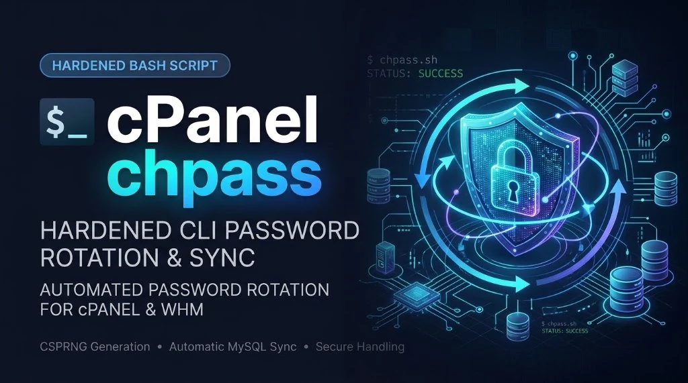

[🇺🇸 English](README.md) | [🇧🇷 Português (BR)](README-ptbr.md) | 🇪🇸 **Español**

# cpanel-chpass — Cambiador y Rotador Seguro de Contraseñas cPanel/WHM

[](LICENSE)
[](https://github.com/sr00t3d/cpanel-chpass/releases)
[](chpass.sh)



**`chpass.sh`** es una CLI en Bash para cambiar y rotar contraseñas de cuentas cPanel/WHM (con sincronización de MySQL) usando la API oficial **`whmapi1 passwd`** (con fallback a `/scripts/chpass`), generación CSPRNG (`/dev/urandom`), protección estricta contra `root` / `UID < 500`, rotación por lotes/revendedor, `--dry-run`, guardado en `chmod 600` y salidas `table`, `json` y `csv`.

> **Inspiración Histórica:** Reimplementación limpia en Bash inspirada en `chpass` (`ecpp_2.pl`, 2012, **Michael Karr** / HostGator Toolbox).

---

## Ejecución Directa (Linux / cPanel)

```bash
bash <(curl -fsSL https://raw.githubusercontent.com/sr00t3d/cpanel-chpass/main/chpass.sh) alice --dry-run
```

---

## Instalación y Uso

```bash
git clone https://github.com/sr00t3d/cpanel-chpass.git
cd cpanel-chpass
chmod +x chpass.sh

sudo ./chpass.sh alice
sudo ./chpass.sh alice 'Str0ng#Pass2026!' --no-mysql
sudo ./chpass.sh -r myreseller --dry-run -o json
sudo ./chpass.sh -f compromised.txt --save /root/rotated-creds.txt
```

---

## Autor & Licencia

Desarrollado por **Percio Castelo** ([perciocastelo.com.br](https://perciocastelo.com.br)).
Inspirado en `chpass` (`ecpp_2.pl`, 2012, **Michael Karr** / HostGator Toolbox).

Licenciado bajo la [Apache License 2.0](LICENSE).
